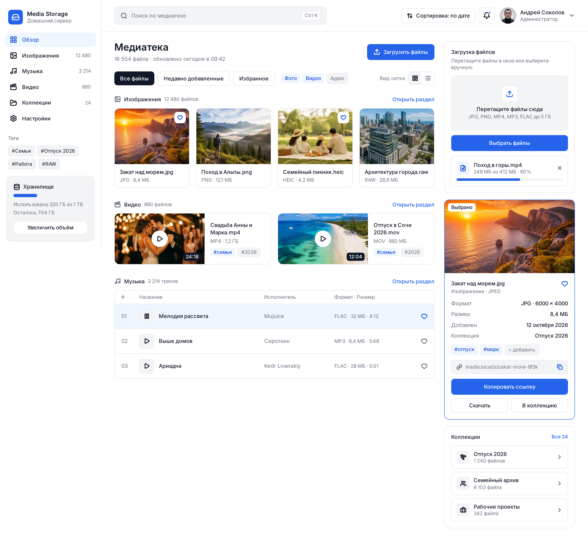

# User Story Mapping — Media Storage

## 1. Назначение документа

Документ описывает пользовательские роли, основные сценарии использования и пользовательские истории для веб-приложения Media Storage.

В качестве основы используется выбранная UI-концепция: 

Дополнительно учитывается необходимость предоставления доступа к медиаконтенту другим приложениям через API.

## 2. Пользовательские роли (Personas)

### Persona 1. Владелец домашнего медиасервера

**Описание:** пользователь, который хранит изображения, музыку и видео на собственном сервере и управляет ими через браузер.

**Цели:**
- Загружать новые файлы на сервер.
- Быстро находить нужный медиаконтент.
- Просматривать изображения, музыку и видео.
- Организовывать файлы с помощью тегов и коллекций.
- Контролировать использование дискового пространства.

**Основные сценарии:** загрузка файлов, просмотр медиатеки, поиск, группировка и управление файлами.

### Persona 2. Пользователь интегрированных приложений

**Описание:** пользователь, который использует медиаконтент Media Storage в других приложениях, например в системе умного дома или MediaTagger.

**Цели:**
- Получать изображения с сервера для оформления дашборда.
- Использовать музыкальные файлы в сценариях автоматизации.
- Просматривать серверную медиатеку из MediaTagger вместе с локальными файлами.
- Получать доступ к нужным файлам без создания дополнительных копий.

**Основные сценарии:** получение ссылки на файл, использование API и подключение совместимых приложений.

### Persona 3. Администратор медиасервера

**Описание:** пользователь, отвечающий за настройки хранилища и доступ к медиатеке.

**Цели:**
- Просматривать состояние и заполненность хранилища.
- Настраивать параметры приложения.
- Управлять доступом к API и интеграциям.
- Обеспечивать доступность медиаконтента для подключённых систем.

**Основные сценарии:** настройка приложения, просмотр состояния хранилища и конфигурирование интеграций.

В первой версии роли владельца и администратора могут быть совмещены одним пользователем.

## 3. Основные пользовательские сценарии (User Journeys)

### Сценарий 1. Загрузка и организация новых файлов

**Роль:** владелец домашнего медиасервера.

**Цель:** сохранить новые изображения, музыку или видео и организовать их в медиатеке.

**Счастливый путь:**

1. Пользователь открывает Media Storage.
2. Нажимает кнопку «Загрузить файлы».
3. Выбирает один или несколько файлов.
4. Система проверяет возможность загрузки и показывает её прогресс.
5. После завершения загрузки новые файлы появляются в медиатеке.
6. Пользователь открывает сведения о файле.
7. При необходимости назначает теги или добавляет файл в коллекцию.

**Ожидаемый результат:** файлы сохранены на сервере и доступны для просмотра и организации.

### Сценарий 2. Поиск и просмотр медиаконтента

**Роль:** владелец домашнего медиасервера.

**Цель:** найти нужный файл среди большого количества медиаданных.

**Счастливый путь:**

1. Пользователь открывает медиатеку.
2. Выбирает раздел «Изображения», «Музыка» или «Видео» либо использует общий поиск.
3. Вводит название файла или выбирает фильтр.
4. Система отображает подходящие результаты.
5. Пользователь открывает нужный файл.
6. Система показывает доступный просмотр и сведения о файле.

**Ожидаемый результат:** пользователь находит нужный файл и получает доступ к его содержимому и метаданным.

### Сценарий 3. Группировка медиаконтента

**Роль:** владелец домашнего медиасервера.

**Цель:** организовать файлы по темам и упростить повторный поиск.

**Счастливый путь:**

1. Пользователь открывает медиатеку.
2. Выбирает файл.
3. Добавляет существующие теги или создаёт новые.
4. При необходимости добавляет файл в коллекцию.
5. Открывает коллекцию или применяет фильтр по тегу.
6. Система отображает все подходящие файлы.

**Ожидаемый результат:** пользователь может находить связанные файлы без необходимости помнить их точные названия.

### Сценарий 4. Использование медиаконтента в другой системе

**Роль:** пользователь интегрированных приложений.

**Цель:** использовать изображение или музыкальный файл в системе умного дома либо получить доступ к серверной медиатеке из MediaTagger.

**Счастливый путь:**

1. Пользователь находит нужный файл в Media Storage.
2. Открывает сведения о файле.
3. Получает ссылку или идентификатор ресурса.
4. Настраивает использование ресурса в совместимом приложении.
5. Подключённое приложение обращается к API или получает файл по предусмотренному адресу.
6. При наличии необходимых прав приложение получает доступ к медиаконтенту.

**Ожидаемый результат:** другой системе доступен нужный медиаресурс без обязательного создания отдельной копии файла.

## 4. Карта пользовательских историй (User Story Mapping)

Истории сгруппированы по этапам пользовательского взаимодействия. Приоритеты определяют порядок реализации MVP.

| Этап | User Story | Приоритет |
|---|---|---|
| Доступ к медиатеке | US-01. Просмотр медиатеки | Must have |
| Загрузка файлов | US-02. Загрузка новых файлов | Must have |
| Поиск | US-03. Поиск и фильтрация | Must have |
| Просмотр файла | US-04. Просмотр сведений о файле | Must have |
| Организация | US-05. Работа с тегами и коллекциями | Must have |
| Получение доступа | US-06. Копирование ссылки на файл | Must have |
| Интеграции | US-07. Получение медиаконтента через API | Must have |
| Настройки | US-08. Просмотр состояния хранилища | Should have |
| Интеграции | US-9. Управление подключениями внешних систем | Nice to have |

Приоритет Must have у API обусловлен назначением продукта: возможность интеграции с другими системами является одним из основных требований Media Storage. Реализация полноценных экранов управления интеграциями при этом может быть отложена.

## 5. User Stories и критерии приёмки

### US-01. Просмотр медиатеки

**Приоритет:** Must have.

**История:** Как владелец домашнего медиасервера, я хочу просматривать изображения, музыку и видео в отдельных разделах, чтобы быстро находить нужный тип медиаконтента.

**Критерии приёмки:**

- **Given:** пользователь открыл Media Storage, When: он выбирает раздел «Изображения», Then: система показывает доступные изображения.
- **Given:** в хранилище есть музыкальные файлы, When: пользователь открывает раздел «Музыка», Then: система показывает список доступных композиций.
- **Given:** в выбранной категории нет файлов, When: пользователь открывает раздел, Then: система показывает сообщение «Файлы отсутствуют» и не отображает фиктивные записи.

### US-02. Загрузка новых файлов

**Приоритет:** Must have.

**История:** Как владелец домашнего медиасервера, я хочу загружать файлы через веб-интерфейс, чтобы хранить новые медиаданные на сервере.

**Критерии приёмки:**

- **Given:** пользователь выбрал поддерживаемый файл, When: он запускает загрузку, Then: система сохраняет файл и показывает результат операции.
- **Given:** файл загружается, When: пользователь просматривает очередь загрузки, Then: система показывает имя файла и состояние загрузки.
- **Given:** пользователь выбрал файл неподдерживаемого формата, When: система проверяет файл, Then: загрузка отклоняется с понятным сообщением.
- **Given:** сервер недоступен во время загрузки, When: операция завершается ошибкой, Then: система сообщает о неудаче и предлагает повторить попытку.

### US-03. Поиск и фильтрация

**Приоритет:** Must have.

**История:** Как владелец домашнего медиасервера, я хочу искать и фильтровать файлы, чтобы находить нужные материалы в большой медиатеке.

**Критерии приёмки:**

- **Given:** в медиатеке есть файлы с разными названиями, When: пользователь вводит часть названия, Then: система показывает совпадающие результаты.
- **Given:** пользователь выбрал фильтр «Видео», When: фильтр применяется, Then: отображаются только видеофайлы.
- **Given:** пользователь очистил строку поиска и сбросил фильтры, When: обновляется список, Then: система показывает все доступные файлы текущего раздела.
- **Given:** совпадений нет, When: пользователь выполняет поиск, Then: система показывает сообщение «Ничего не найдено».

### US-04. Просмотр сведений о файле

**Приоритет:** Must have.

**История:** Как владелец домашнего медиасервера, я хочу просматривать подробную информацию о файле, чтобы понимать его формат, размер и принадлежность к коллекциям.

**Критерии приёмки:**

- **Given:** файл существует, When: пользователь открывает его карточку, Then: система показывает доступные сведения о файле.
- **Given:** у файла назначены теги, When: пользователь открывает сведения, Then: теги отображаются в информационной панели.
- **Given:** файл был удалён или стал недоступен, When: пользователь пытается открыть его сведения, Then: система сообщает, что ресурс недоступен.

### US-05. Работа с тегами и коллекциями

**Приоритет:** Must have.

**История:** Как владелец домашнего медиасервера, я хочу группировать файлы по тегам и коллекциям, чтобы упрощать навигацию по медиатеке.

**Критерии приёмки:**

- **Given:** пользователь выбрал файл, When: он добавляет тег, Then: тег сохраняется и отображается в сведениях о файле.
- **Given:** несколько файлов относятся к одной теме, When: пользователь открывает соответствующую коллекцию, Then: система показывает файлы этой коллекции.
- **Given:** пользователь удаляет тег у файла, When: изменение сохранено, Then: тег больше не отображается у этого файла.
- **Given:** пользователь указал пустое название новой коллекции, When: он пытается её создать, Then: система показывает ошибку валидации.

### US-06. Копирование ссылки на файл

**Приоритет:** Must have.

**История:** Как владелец домашнего медиасервера, я хочу копировать ссылку на медиаресурс, чтобы использовать его в других приложениях.

**Критерии приёмки:**

- **Given:** файл доступен и пользователь имеет право на его получение, When: он нажимает «Копировать ссылку», Then: система копирует предусмотренный адрес ресурса.
- **Given:** браузер не разрешил копирование в буфер обмена, When: пользователь копирует ссылку, Then: система сообщает об ошибке и позволяет получить адрес другим предусмотренным способом.
- **Given:** пользователь открыл скопированную ссылку в поддерживаемом клиенте с необходимыми правами, When: клиент запрашивает ресурс, Then: сервер предоставляет доступ к файлу.

### US-07. Получение медиаконтента через API

**Приоритет:** Must have.

**История:** Как разработчик или пользователь интегрированной системы, я хочу получать список медиаресурсов и обращаться к отдельным файлам через API, чтобы использовать их в других приложениях.

**Критерии приёмки:**

- **Given:** клиент имеет необходимые права доступа, When: он запрашивает список медиаресурсов через API, Then: сервер возвращает список доступных ресурсов в документированном формате.
- **Given:** клиент имеет доступ к существующему файлу, When: он запрашивает этот ресурс, Then: сервер возвращает файл или предоставляет предусмотренный способ его получения.
- **Given:** клиент не прошёл необходимую авторизацию, When: он обращается к защищённому ресурсу, Then: сервер отклоняет запрос и возвращает соответствующий ответ об отсутствии авторизации или прав.
- **Given:** запрошенный ресурс отсутствует, When: клиент обращается к нему, Then: API возвращает ответ об отсутствии ресурса.

### US-08. Просмотр состояния хранилища

**Приоритет:** Should have.

**История:** Как администратор медиасервера, я хочу видеть объём занятого и свободного места, чтобы контролировать заполненность хранилища.

**Критерии приёмки:**

- **Given:** сервер предоставляет сведения о дисковом пространстве, When: пользователь открывает обзор, Then: система показывает доступные показатели заполненности.
- **Given:** сведения о состоянии хранилища временно недоступны, When: пользователь открывает обзор, Then: система показывает, что данные не удалось получить, вместо вымышленных значений.

### US-09. Управление подключениями внешних систем

**Приоритет:** Nice to have.

**История:** Как администратор медиасервера, я хочу просматривать подключённые внешние системы, чтобы понимать, какие приложения используют медиатеку.

**Критерии приёмки:**

- **Given:** в системе предусмотрен учёт интеграций, When: администратор открывает раздел «Интеграции», Then: система показывает доступные сведения о подключениях.
- **Given:** подключённых систем нет, When: администратор открывает раздел, Then: система показывает пустое состояние с пояснением.
- **Given:** интеграция требует настройки доступа, When: администратор открывает её параметры, Then: система предоставляет предусмотренные средства настройки либо документацию.

## 6. Обработка ошибок и альтернативные сценарии

| Ситуация | Ожидаемое поведение системы |
|---|---|
| Файл неподдерживаемого формата | Показать понятное сообщение, не добавлять файл в медиатеку |
| Файл превышает допустимый размер | Сообщить об ограничении до начала загрузки, если размер известен |
| Потеря сетевого соединения | Показать ошибку, сохранить доступное состояние очереди и предложить повторить загрузку |
| Пустая медиатека | Показать сообщение об отсутствии файлов и кнопку загрузки |
| Поиск без результатов | Показать сообщение «Ничего не найдено» и предложить изменить запрос |
| Недостаточно места на диске | Сообщить о невозможности загрузки и необходимости освободить место |
| Нет авторизации или прав доступа | Не предоставлять защищённый ресурс и показать понятное сообщение |
| Запрашиваемый файл удалён | Сообщить, что ресурс не найден или недоступен |
| Ошибка получения сведений о хранилище | Показать состояние недоступности данных, не подставлять фиктивные показатели |

## 7. Приоритеты реализации

### Must have — обязательные функции MVP

- Просмотр изображений, музыки и видео.
- Загрузка файлов на сервер.
- Поиск и фильтрация медиаконтента.
- Просмотр сведений о файлах.
- Организация файлов с помощью тегов и коллекций.
- Получение ссылки на файл.
- Базовый API для доступа к медиаресурсам с проверкой прав доступа.

### Should have — желательно реализовать

- Просмотр состояния дискового пространства.
- Дополнительные способы сортировки и фильтрации.

### Nice to have — функции дальнейшего развития

- Полноценная панель управления подключениями.
- Расширенные настройки интеграций.
- Дополнительные инструменты администрирования.

## 8. Итог

Карта пользовательских историй охватывает основные действия пользователя в Media Storage: от загрузки и организации медиаконтента до его предоставления внешним приложениям.

Для MVP в первую очередь необходимы базовые функции управления медиатекой и программный доступ к файлам. Дополнительные административные возможности могут быть реализованы на следующих этапах.

User Stories и критерии приёмки будут использованы при подготовке технического задания и проверке полноты требований перед началом разработки.